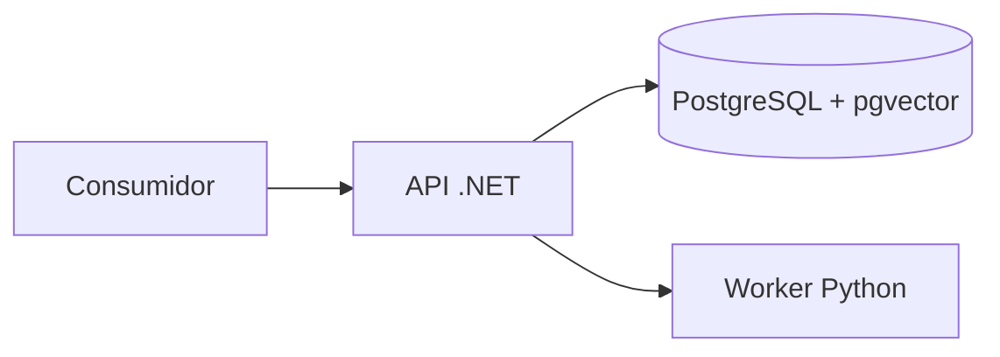

# Arquitectura técnica inicial

La API .NET será responsable de identidad, autorización, dominio documental, orquestación, búsqueda y evidencias. PostgreSQL con pgvector almacenará los datos y realizará búsqueda léxica y vectorial. El worker Python será responsable de procesamiento documental e inferencia local cuando se implementen esas capacidades. Su protocolo interno y manejo de errores se definirán al implementar el primer flujo.

Hoy sólo existen procesos de salud independientes y la infraestructura de PostgreSQL; las flechas describen la arquitectura prevista, no integraciones ya implementadas.

La recuperación prevista filtra permisos antes/durante FTS y vector, combina candidatos con RRF, aplica reranking y vuelve a comprobar permisos al expandir contexto. El servicio devuelve evidencias con procedencia; un LLM generativo no es requisito. El FTS en español y la búsqueda de identificadores exactos se probarán por separado: un índice lingüístico por sí solo no garantiza coincidencias de símbolos técnicos.

No hay autenticación, aislamiento ni protección de documentos todavía: ejecutar únicamente con datos sintéticos. La autorización corporativa, revocación y propagación de ACL son requisitos para cualquier piloto real. No enviar documentos a servicios externos sin autorización.

Modelos, dimensiones vectoriales, licencias, versiones y recursos CPU/GPU se decidirán después de validar compatibilidad y métricas. No se fija HNSW hasta verificar que la dimensión y el tipo vectorial elegidos sean compatibles con la versión de pgvector.
