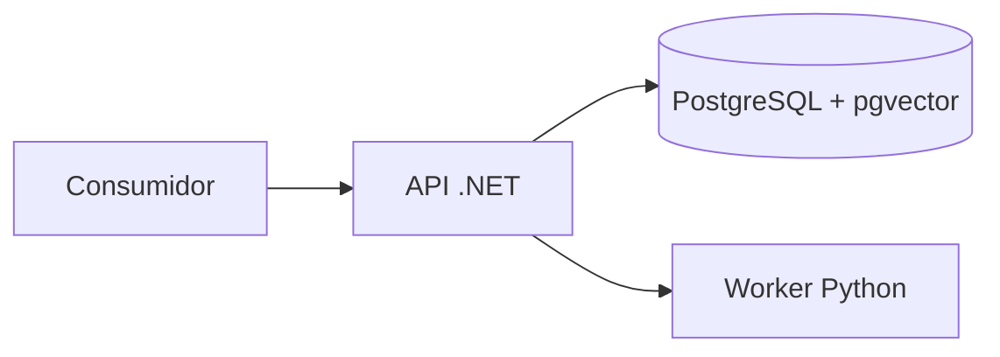

# Arquitectura técnica inicial

La API .NET será responsable de identidad, autorización, dominio documental, orquestación, búsqueda y evidencias. PostgreSQL con pgvector almacenará los datos y realizará búsqueda léxica y vectorial. El worker Python será responsable de procesamiento documental e inferencia local cuando se implementen esas capacidades. Su protocolo interno y manejo de errores se definirán al implementar el primer flujo.

Hoy existen procesos de salud independientes, infraestructura PostgreSQL, una migración SQL inicial y un endpoint de desarrollo que consulta PostgreSQL. La integración con Python y el flujo de retrieval son arquitectura prevista.

El ejecutor de migraciones aplica archivos SQL en orden, registra SHA-256 y usa un bloqueo de sesión y una transacción por archivo. Los archivos ya aplicados no deben editarse; los cambios se agregan en una migración nueva. No adopta bases migradas manualmente ni revierte versiones de forma automática.

La recuperación prevista filtra permisos antes/durante FTS y vector, combina candidatos con RRF, aplica reranking y vuelve a comprobar permisos al expandir contexto. El servicio devuelve evidencias con procedencia; un LLM generativo no es requisito. El FTS en español y la búsqueda de identificadores exactos se probarán por separado: un índice lingüístico por sí solo no garantiza coincidencias de símbolos técnicos.

La migración define permisos de lectura individuales por documento y una consulta que exige un permiso explícito y estado aprobado. La revocación se refleja en la siguiente consulta. `/dev/chunks` está disponible sólo en Development y usa una única identidad fijada en la configuración del servidor; no autentica personas ni acepta identidad del cliente. Es un mecanismo parcial: no existe identidad verificada ni restricción de acceso directo a tablas. Ejecutar únicamente con datos sintéticos. La autorización corporativa y propagación de ACL son requisitos para cualquier piloto real. No enviar documentos a servicios externos sin autorización.

Modelos, dimensiones vectoriales, licencias, versiones y recursos CPU/GPU se decidirán después de validar compatibilidad y métricas. No se fija HNSW hasta verificar que la dimensión y el tipo vectorial elegidos sean compatibles con la versión de pgvector.
